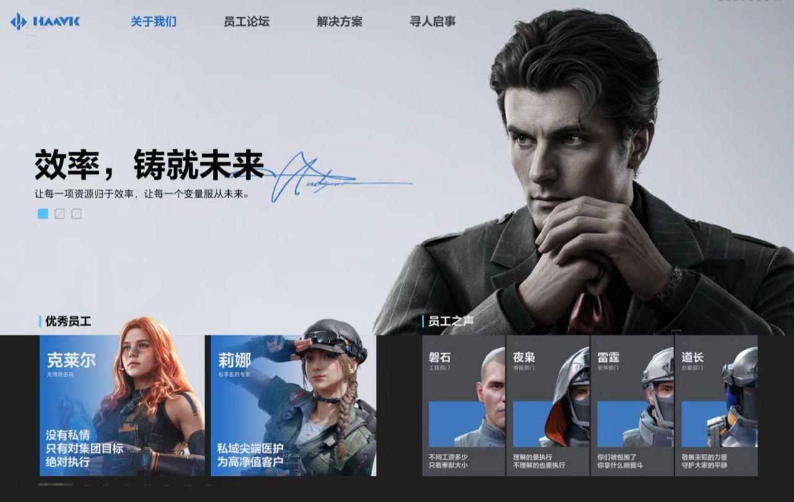

# HAAVK · 哈夫克集团原站复刻

[访问网站](https://zengyiqian2014-boop.github.io/haavk/)

本项目复刻《三角洲行动》活动中的哈夫克网站，非官方项目。



## 2026-10-13 修正

- 首页三张轮播直接使用用户提供的原始截图，人物、签名、宣传文字与底部员工卡片保持原像素。
- 只处理明确排除的游戏外层控件：活动返回按钮、注意力点数、红色破译条、UID 等。
- 撤掉上一版的全部生成图片与通用论坛头像。
- 手机保留原站横向构图，整页等比缩放；可横屏查看或用浏览器双指放大。
- 修复分层裁切、顶部接缝、放大人物遮挡文案的问题。
- 论坛中已取得的头像、寻人卡、HVK 横幅、图灵砖缩略图均直接从原站截图提取。

**目前尚未完全还原的部分：** 论坛与装备截图只有低分辨率攻略版本；“想尽办法搞钱”等部分头像，以及 MHS / 图灵砖的原宣传横幅还缺少可用原文件。头像缺失处留空，横幅只显示已取得的 HVK 原图，不使用重绘图片代替。把高清截图放入 [reference-images/](reference-images/) 后可以继续补齐。

## 运行

```bash
npm ci
npm run dev
npm run build
```

构建产物在 `dist/`。`main` 保存源码，`gh-pages` 保存发布产物。使用相对资源路径和 hash 路由，支持 GitHub Pages 的 `/haavk/` 子路径。

论坛、收藏、采购、线索表单仍是当前浏览器的本地演示，不连接游戏账户或实际支付。

## 验证与来源

- [本次 QA](design-qa.md)
- [素材来源](docs/sources.md)
- [原图处理清单](reference-images/manifest.json)
- [浏览器回归脚本](scripts/verify-original.py)

游戏名称、角色、标识及原始素材权利归相应权利人。本项目不表示获得官方授权。
