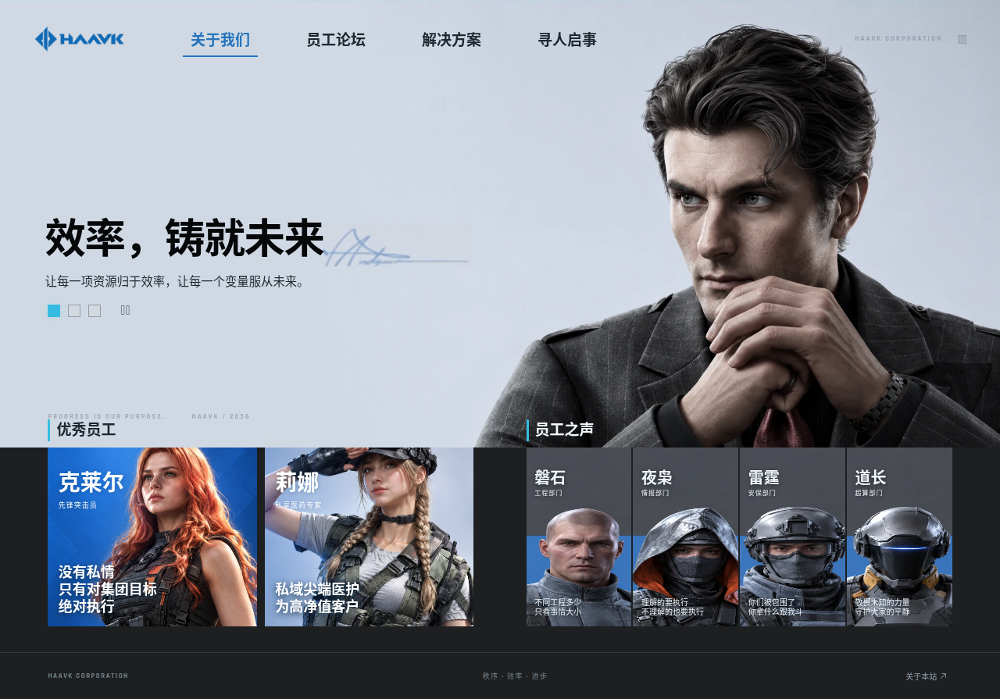

# HAAVK · 哈夫克集团

《三角洲行动》「骇爪的网上冲浪」活动中，哈夫克集团网站的非官方前端复刻。

源码和发布产物已上传。GitHub 连接未获 Pages 设置权限（API 返回 403），需在 [Pages 设置](https://github.com/zengyiqian2014-boop/haavk/settings/pages) 中选择 **Deploy from a branch → gh-pages → / (root) → Save**。

启用后的访问地址：<https://zengyiqian2014-boop.github.io/haavk/>



## 页面与交互

- **关于我们**：三组集团宣传轮播、优秀员工资料、员工之声。
- **员工论坛**：主题列表、帖子详情、阅读状态、点赞、发帖和回复。
- **解决方案**：三组产品横幅、七件装备、属性抽屉、收藏和采购演示。
- **寻人启事**：H42 / 佐娅资料卡与线索表单。

采用冷灰蓝配色、缓慢扫描线、肖像淡入、标题切换、抽屉过渡与悬停反馈；支持手机排版和系统减少动态效果设置。

按需求移除了游戏外层的「活动」返回按钮、注意力点数、破译点数、红色侧条、UID 和网络状态。

论坛、收藏、采购、线索仅保存在当前浏览器的 `localStorage` 中。不连接游戏账户，不涉及实际支付或道具发放。清除本站浏览器数据会重置这些演示状态。

## 本地运行

需要 Node.js 20.19+ 或 22.12+。

```bash
npm ci
npm run dev
```

```bash
npm run build
npm run preview
```

`dist/` 是可独立部署的静态网站。使用相对资源路径和 hash 路由，支持 `/haavk/` 等子路径。

## 项目结构

```text
src/main.js       页面、路由、轮播和本地交互
src/data.js       宣传内容、论坛、装备数据
src/style.css     桌面 / 手机布局与动画
public/assets/   本地图片、字体
docs/sources.md  参考与素材来源
docs/qa/         浏览器截图与验证结果
design-qa.md     视觉核对记录
```

主分支保存源码；`gh-pages` 分支保存构建产物。更新发布时先运行 `npm run build`，再将 `dist/` 内容发布到 `gh-pages` 分支根目录。GitHub Pages 设置为 **Deploy from a branch → gh-pages → / (root)**。

## 素材说明

布局与主要内容依据用户提供的截图和公开活动攻略；装备使用公开图鉴图片。人物、Logo、图灵砖为参考重绘，并非官方原始高清资源。未获得原始 MP4，动画根据科技感风格重新实现。部分未完整展示的帖子内容作了演示补全。

这是非官方的学习与展示项目。游戏名称、角色、标识及原始素材权利归相应权利人。详细出处见 [素材记录](docs/sources.md)。

## 验证

已验证生产构建、子路径资源加载、主要交互、状态持久化以及 360 / 390 / 768 / 1280 / 1920 像素宽度下的布局。详见 [QA 记录](design-qa.md)。
